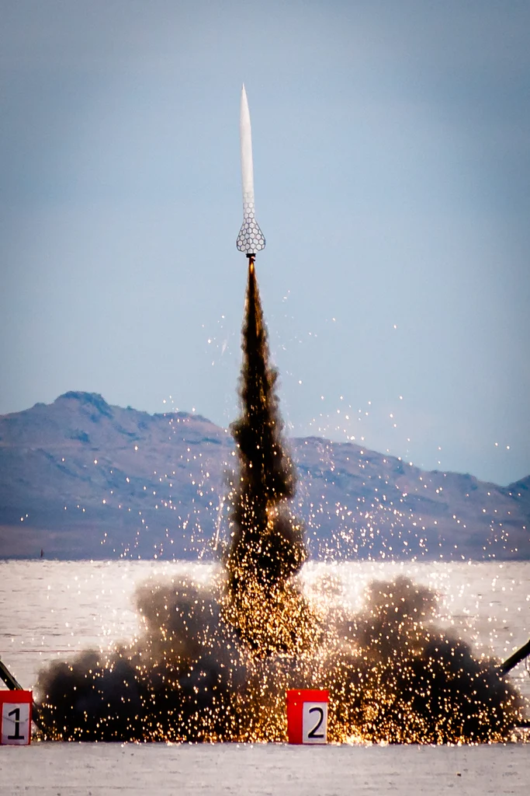

# Deployment

Content coming soon.

## Motor Ejection 

The most common ejection type you will see for L1 certifications are motor ejection, where a delay grain burns for an adjustable time (typically 4-14 seconds) and then ignites some black powder, letting the main parachute out. 

## Dual Separation Dual Deploy (DSDD)

This is the most common version of dual deploy, where two separate charges opens the rocket at two different points, first letting out a drogue parachute at apogee, followed by the second charge letting out the main parachute at an adjustable altitude. The rocket specifically has a nosecone, forward section ahead of AV bay, AV bay, and fincan. 

## Head End Dual Deploy (HEDD)

An alteration of DSDD, where instead of having a forward section, the nosecone interfaces directly with the AV bay coupler. This typically requires a more compact main parachute to accomplish. A great example of a kit rocket using HEDD is the Wildman Punisher. 

## Single Separation Dual Deploy (SSDD)

This is yet another version of dual deploy. SSDD is typically used for smaller, higher performance rockets, where the weight of the rocket matters. As the name suggests, there is only one separation event of the rocket at apogee, and the main parachute is either inhibited from opening using zipties and a cable cutter, or the parachute is reefed. Thus, the second event is a charge allowing the parachute to open. 