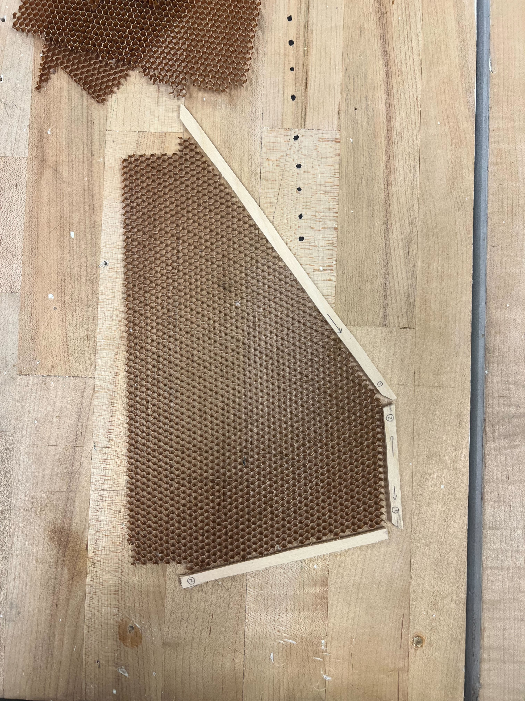
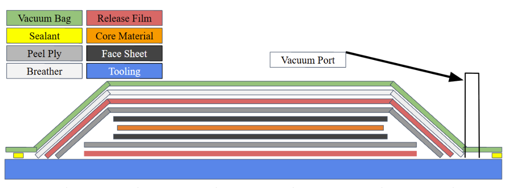
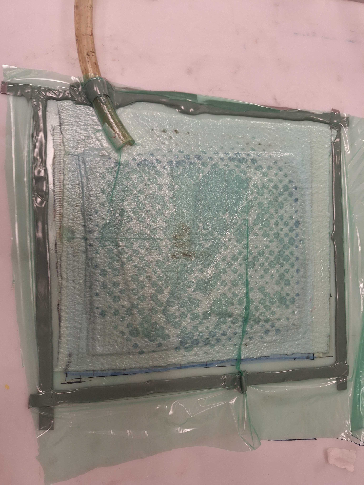
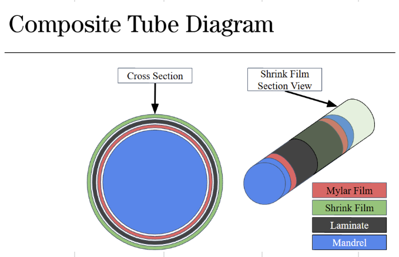
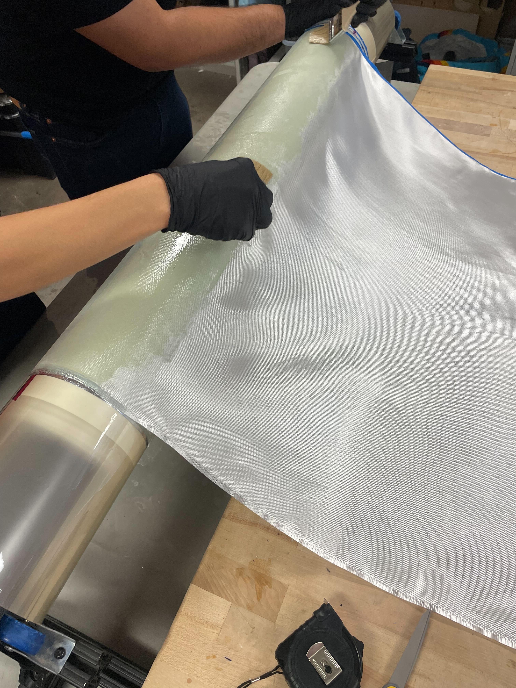
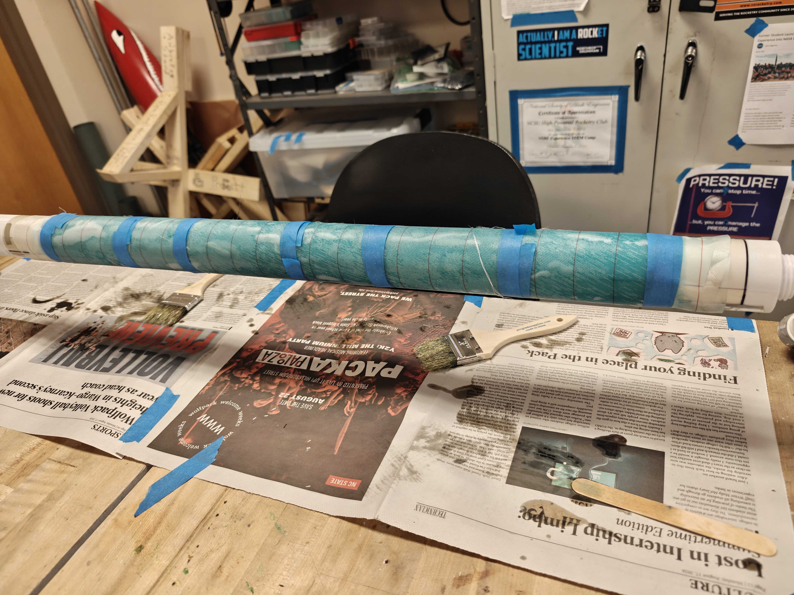
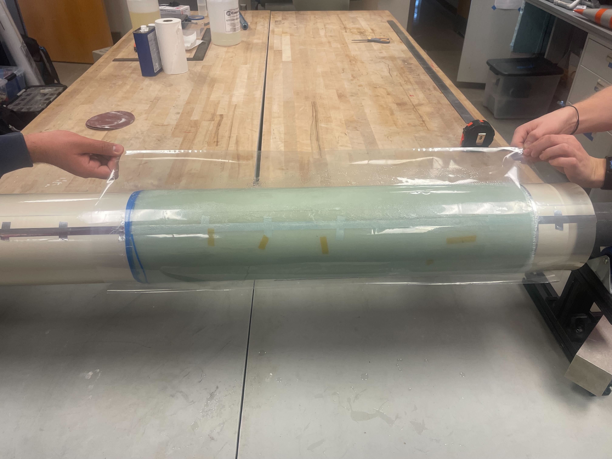
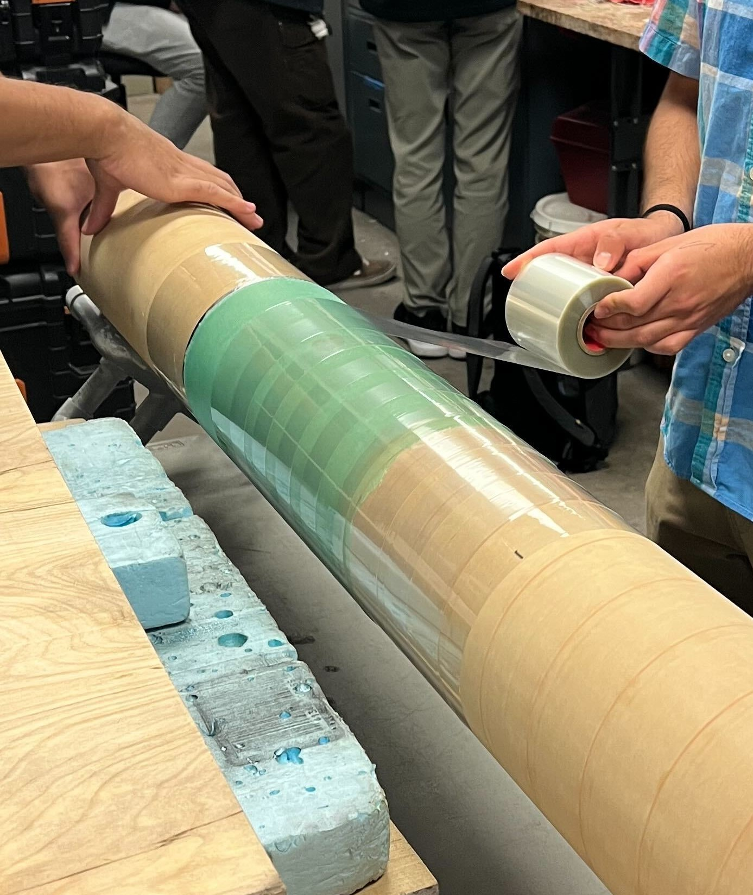
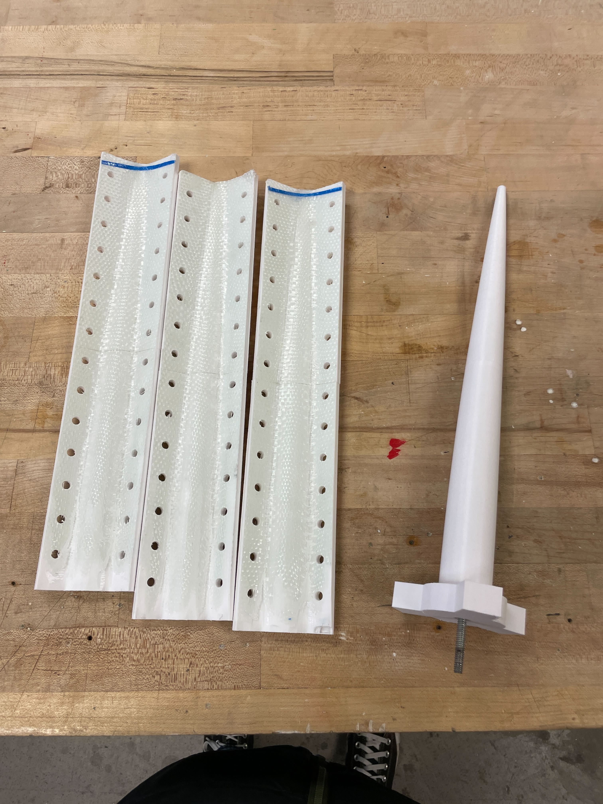
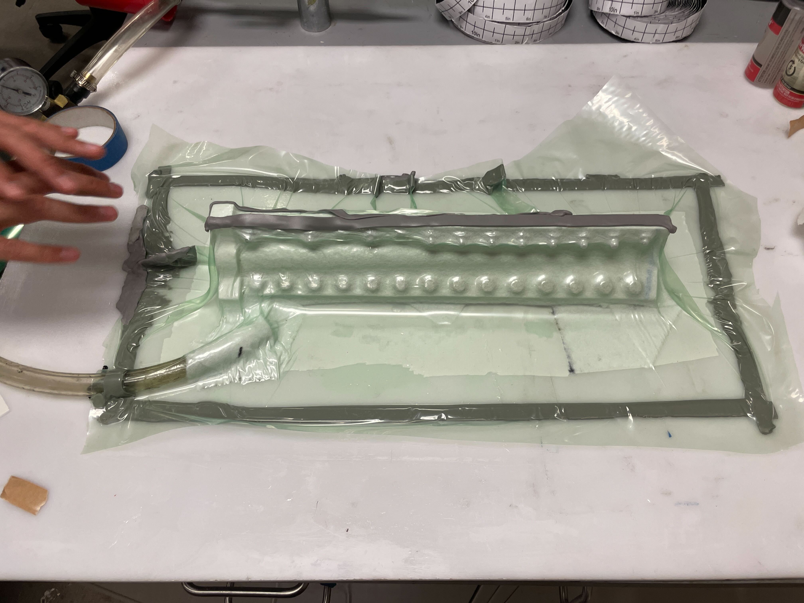

# Composites

This page covers composite materials and techniques for rocket construction.

When working with high-powered rockets, it is inevitable that you encounter composites. Most higher-performance flights (> mach 0.6) typically utilize composite airframes, either carbon fiber or fiberglass. 

## Carbon Fiber vs Fiberglass
Carbon fiber is generally about 30 % stronger for the same length, so it is desirable to use over fiberglass. However, consideration should be given to RF-transparancy. As carbon fiber is conductive, it is also RF-blocking, and should therefore not be used in any sections where a GPS or transmitter is located. Thus, a rocket using a nosecone AV bay should use a fiberglass nosecone, while the airframe itself is fine to be made of carbon fiber. 

## Manufacturing

### Flat plates
A flat plate is the simplest layup to make. A flat plate can be made using just the fiber material, or it can be a composite sandwich using some form of core material, such as balsa wood or honeycomb nomex. The flat plate process can be used for both bulkhead and fin layups.

*An example of a fin core using honeycomb nomex.*

In HPRC, we like to pull vacuum on our composites for extra compression, but if you do not have the equipment, heavy weights or other items can be used to apply compression instead. 

When doing a layup, you should use as flat of a surface as possible. HPRC uses acryllic boards, as those can be moved around as needed. First, we start with a layer of mylar, then a layer of peel ply. Next is the composite materials themselves. Afterwards goes another layer of peel ply, perforated film, breather, and finally the vacuum bagging. To seal the vacuum bag, we utilize butyl tape

As for sizing, everything measured relative to the core of the material. For example, the core is 6" by 4", then the peel ply would be cut to 8" by 6"

| Layer | Size Added Relative to Core |
| ----- | --------------------- |
| Peel Ply | 2" |
| Mylar | 3" |
| Fiberglass/Carbon Fiber | 1" |
| Perforated Film | 2" |
| Breather | 2" |
| Vacuum Bagging | 5" |

### Tubes
Laying up a tube can be accomplished in a few ways. It can be made using a filament winder, composite sleeves, and hand-rolled using the same composite cloth as a plate. 

When making a tube, some sort of material is required for a mandrel. Some options include commercial coupler tubes, be it composites or phenolic, aluminum stock, typically machined to achieve a specific inner diameter, or, as we use, 3D-printed modular mandrels. The mandrel should be very smooth, so sanding up to a grit of #800 - #1200 can be beneficial. 

As with a plate layup, we start with a layer of mylar, which is taped as tightly against itself as possible using mylar tape. Next, the composite layers are applied. If using cloth, you should cut one continuous piece of cloth that will be rolled over the mandrel. If using sleeve, cut the desired number of layers of sleeve, then apply and wet them out one by one. 

For applying compression and finishing the surface, multiple methods can be used. Mylar or peel ply can be used for a smooth surface, however, almost no compression is applied. Heat shrink tape or heat shrink tube can be used with better results. However, it is important to know the glass transition temperature of the used epoxy as well as the mandrel, thus heating should not be applied in the same location for an extended period of time. Additionally, be careful of epoxy bubbles bursting through the heat shrink material, as it can shoot far and potentially hit you or someone else. 

*The order of materials as used by HPRC.*

*In the middle of rolling a tube.*

*An example of a tube using peel ply for surface finish.*

*In the middle of applying heat shrink tubing.*

*Application of heat shrink tape. Notice the hands pulling tension during the application of the tape.*

### Nosecones
Just like with tubes, nosecones can be made in multiple ways. By far the easiest way is by using composite sleeves. However, if you're up for a challenge, a nosecone can also be made using flat cloth cut into multiple gores, then laid up against either a male or female mold. 

Typically, a nosecone is laid up on a 3D-printed male plug. From there, you can decide to also use a female other mold for compression. If you're using sleeves, you can also ziptie both ends and hang a weight to compress the material. 

Since you can't easily cover the mold using mylar, other materials have to be used for mold release. For smaller nosecones (Up to around 4" diameter), condoms can be used with great success, assuming you can get it on the nosecone mold ([see BPS.Space's great video](https://www.youtube.com/watch?v=jRbXzujI6ho)). If that is not possible, using 3-5 layers of Partall #2 mold release followed by 2-3 coats of liquid PVA, such as Partall film #10. 

*This is an example of a compression mold. Below is the same mold in vacuum.*
